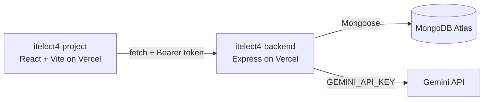

Website Link: https://itelect4-backend-six.vercel.app/

# itelect4-backend

[](https://github.com/rnzndrei/itelect4-backend/actions/workflows/ci.yml)

The REST API behind the Library System: Express in TypeScript, MongoDB Atlas through Mongoose, JWT authentication, and one route that asks Gemini to review book request descriptions.

- **Live API:** https://itelect4-backend-six.vercel.app/api/health
- **Frontend repo:** https://github.com/rnzndrei/itelect4-project

## Architecture



## Features

- User Authentication: JWT-based registration and login with bcrypt password hashing.
- Book Management: CRUD operations for library books with availability tracking.
- Transaction System: Book borrowing requests with status lifecycle (REQUESTED → APPROVED → BORROWED → RETURNED).
- AI Research Assistant: Gemini-powered analysis of book request descriptions with structured JSON output validated by Zod.
- Rate Limiting: Five AI reviews per minute per user to protect quota.
- CORS Protection: Configurable origin whitelist for secure cross-origin requests.

## Tech Stack

- Runtime: Node.js
- Framework: Express
- Language: TypeScript
- Database: MongoDB Atlas via Mongoose
- Authentication: JSON Web Tokens (JWT) & bcryptjs
- AI: Google Gemini API (@google/genai SDK)
- Validation: Zod schemas
- Testing: Vitest + Supertest
- Deployment: Vercel

## Local Setup

1. Clone the repository:
   git clone https://github.com/rnzndrei/itelect4-backend.git
   cd itelect4-backend
2. Install dependencies:
   npm install
3. Set up environment variables:
Create a .env file in the root directory with:
   MONGODB_URI=your_mongodb_connection_string
   JWT_SECRET=your_super_secret_jwt_key
   CORS_ORIGIN=http://localhost:5173,https://itelect4-project-iota.vercel.app
   GEMINI_API_KEY=your_gemini_api_key
   PORT=4000
4. Seed the database (optional):
   npm run seed
5. Start the development server:
   npm run dev
The API will be available at http://localhost:4000.

## API Endpoints

### Public Routes (No Token Required)

| Method | Endpoint | Description |
| :--- | :--- | :--- |
| `GET` | `/api/health` | Checks API and database connection status |
| `GET` | `/api/books` | Returns a list of all available books |
| `GET` | `/api/books/:id` | Returns details for a specific book |
| `POST` | `/api/auth/register` | Creates a new user account |
| `POST` | `/api/auth/login` | Authenticates a user and returns a JWT |

### Protected Routes (Requires `Authorization: Bearer <token>`)

| Method | Endpoint | Description |
| :--- | :--- | :--- |
| `GET` | `/api/transactions` | Returns all transactions for the logged-in user |
| `POST` | `/api/transactions` | Creates a new book request transaction |
| `POST` | `/api/ai` | Analyzes a book request description using Gemini |

## Testing
Run the test suite:
    npm test
Tests include authentication checks, request schema enforcement, and Supertest integration tests.

## AI Use Disclosure

This project uses Google's Gemini API (via the @google/genai SDK) to generate book request reviews. The AI's output is validated against a Zod schema before being sent to clients. The system prompt instructs the model to act as a librarian assistant, and few-shot examples guide the response format. The API key is stored server-side and never exposed to the frontend.

## Project Structure

```
src/
├── ai/
│   ├── gemini.ts        # Gemini client and review function
│   └── prompt.ts        # System prompt and examples
├── config/
│   └── db.ts            # MongoDB connection
├── middleware/
│   └── auth.ts          # JWT verification middleware
├── models/
│   ├── Book.ts          # Book schema
│   ├── Transaction.ts   # Transaction schema
│   └── User.ts          # User schema
├── routes/
│   ├── ai.ts            # AI review route
│   ├── auth.ts          # Authentication routes
│   ├── books.ts         # Book routes
│   └── transactions.ts  # Transaction routes
├── schemas/
│   └── review.ts        # Zod schemas for AI requests/replies
├── types/
│   └── index.ts         # TypeScript interfaces
├── app.ts               # Express app setup
├── seed.ts              # Database seeder
└── server.ts            # Server entry point
tests/
└── ai.test.ts           # Supertest tests for AI route
```
