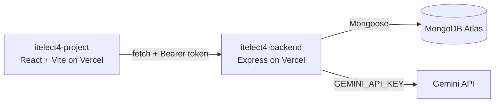

Website Link: https://itelect4-project-iota.vercel.app

# itelect4-project

[](https://github.com/rnzndrei/itelect4-project/actions/workflows/ci.yml)

The frontend of the Library System: React + Vite, deployed on Vercel. Connects to the itelect4-backend API for authentication, book browsing, transactions, and AI-powered request reviews.

- **Live Site:** https://itelect4-project-iota.vercel.app
- **Backend repo:** https://github.com/rnzndrei/itelect4-backend

## Architecture



## Features

- User Authentication: Registration and login with JWT persistence in localStorage.
- Dashboard: Personalized welcome page for logged-in users.
- Book Catalog: Browse available books with real-time availability counts.
- Transaction Management: Request books, view request history, and track status.
- AI Research Assistant: Get AI-powered feedback on book request descriptions.
- Responsive Design: Mobile-friendly interface with dark mode support.
- Form Validation: Client-side validation with Zod schemas and React Hook Form.

## Tech Stack

- Framework: React 18
- Build Tool: Vite
- Language: TypeScript
- State Management: Zustand (auth) & React Query (server state)
- Styling: Tailwind CSS
- Forms: React Hook Form + Zod
- Testing: Vitest + Testing Library
- Deployment: Vercel

## Local Setup
1. Clone the repository:
  git clone https://github.com/rnzndrei/itelect4-project.git
  cd itelect4-project
2. Install dependencies:
  npm install
3. Set up environment variables:
Create a .env file in the root directory with:
  VITE_API_URL=https://itelect4-backend-six.vercel.app
4. Start the development server:
  npm run dev
The app will be available at http://localhost:5173.

## Testing

Run the test suite:
  npm test
Tests include component renders, custom hook state checks, and form validation behavior.

## Pages

| Route | Description | Access |
| :--- | :--- | :--- |
| `/` | Dashboard | Protected |
| `/books` | Book catalog | Public |
| `/transactions` | Transaction management | Protected |
| `/review` | AI Research Assistant | Protected |
| `/login` | Login page | Public |
| `/register` | Registration page | Public |

## AI Use Disclosure

This project uses Google's Gemini API (via the backend) to generate book request reviews. The AI's output is validated against a Zod schema before being displayed to users. The frontend never communicates directly with Gemini; all AI requests go through the backend's /api/ai endpoint.

## Project Structure

```
src/
├── api/
│   └── client.ts          # API client with auth token handling
├── components/
│   ├── Layout.tsx         # Main layout with navigation
│   ├── TransactionBadge.tsx # Transaction status display
│   └── ui/                # shadcn/ui components
├── hooks/
│   └── useToggle.ts       # Custom toggle hook
├── pages/
│   ├── BooksPage.tsx      # Book catalog
│   ├── DashboardPage.tsx  # User dashboard
│   ├── LoginPage.tsx      # Login form
│   ├── NotFoundPage.tsx   # 404 page
│   ├── RegisterPage.tsx   # Registration form
│   ├── ReviewPage.tsx     # AI Research Assistant
│   └── TransactionsPage.tsx # Transaction management
├── schemas/
│   ├── authSchema.ts      # Login/register validation
│   ├── reviewSchema.ts    # AI review form validation
│   └── transactionSchema.ts # Transaction form validation
├── store/
│   ├── authStore.ts       # Zustand auth store
│   └── uiStore.ts         # UI state store
├── types/
│   └── index.ts           # TypeScript interfaces
├── App.tsx                # Main app component with routing
├── main.tsx               # Entry point
└── index.css              # Global styles
```
